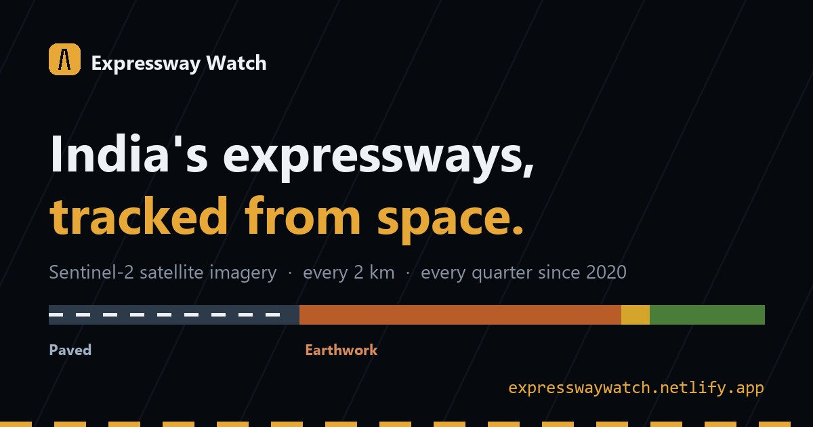
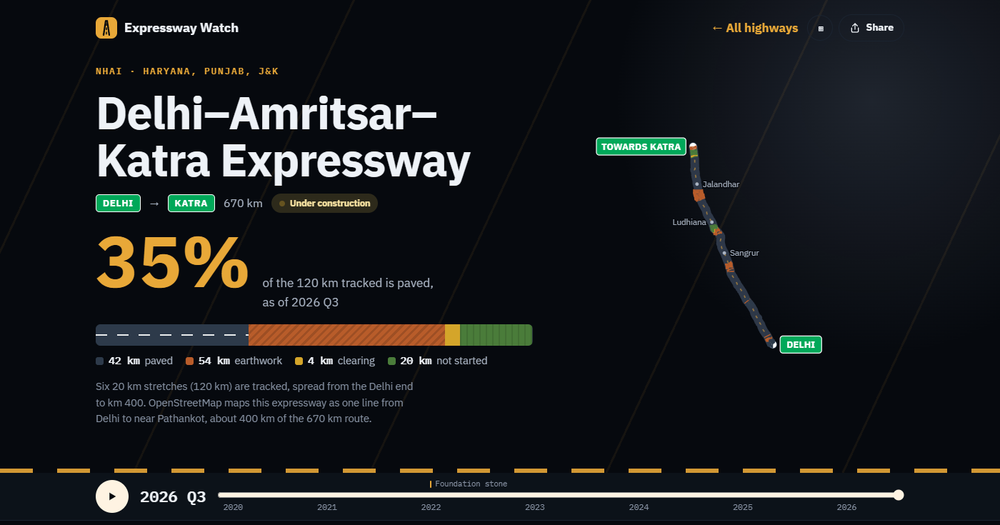
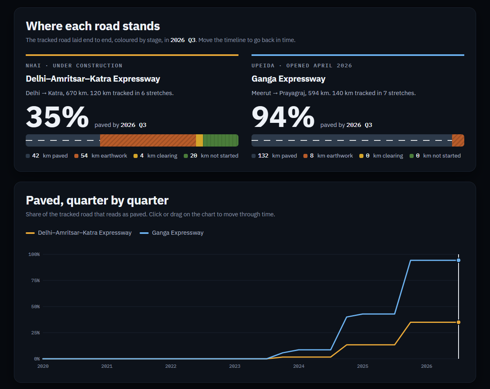

# Expressway Watch

**Tracking India's expressway construction from free satellite imagery, 2 km at a time.**

[](https://expresswaywatch.netlify.app)
[](https://colab.research.google.com/github/Elmozoop/expressway-watch/blob/master/notebooks/Expressway_Watch.ipynb)
[](https://expresswaywatch.netlify.app)

[](https://expresswaywatch.netlify.app)

Expressway Watch takes a highway's route, cuts it into 2 km pieces, and reads every quarter of Sentinel-2 imagery since 2020 to estimate what stage each piece was in: **not started → clearing → earthwork → paved**. It needs no field visits, no paid data and no login, and runs end to end in Google Colab.

### 👉 [Open the live dashboard](https://expresswaywatch.netlify.app)

| Jump straight to | Link |
|---|---|
| Home: the road taken apart in 3D, a satellite time-lapse, how to read it | [expresswaywatch.netlify.app](https://expresswaywatch.netlify.app) |
| Delhi–Amritsar–Katra Expressway (NHAI, still being built) | [/#delhi-amritsar-katra](https://expresswaywatch.netlify.app/#delhi-amritsar-katra) |
| Ganga Expressway (UPEIDA, opened April 2026) | [/#ganga-expressway](https://expresswaywatch.netlify.app/#ganga-expressway) |
| The two side by side | [/#compare/delhi-amritsar-katra/ganga-expressway](https://expresswaywatch.netlify.app/#compare/delhi-amritsar-katra/ganga-expressway) |
| Offline copy (one self-contained file) | [`docs/dashboard.html`](docs/dashboard.html): download it and open it in any browser |

## Contents

- [At a glance](#at-a-glance)
- [What's on the dashboard](#whats-on-the-dashboard)
- [Results: Ganga Expressway](#results-ganga-expressway)
- [Results: Delhi–Amritsar–Katra Expressway](#results-delhiamritsarkatra-expressway)
- [How it works](#how-it-works)
- [Run it yourself](#run-it-yourself)
- [Build and deploy the dashboard](#build-and-deploy-the-dashboard)
- [Repository layout](#repository-layout)
- [Limitations](#limitations)
- [Roadmap](#roadmap) · [Data and credits](#data-and-credits)

## At a glance

| | Ganga Expressway | Delhi–Amritsar–Katra Expressway |
|---|---|---|
| Built by | UPEIDA, Uttar Pradesh | NHAI, Haryana · Punjab · J&K |
| Length | 594 km, Meerut → Prayagraj | 670 km, Delhi → Katra |
| Status | Opened 29 April 2026 | Under construction |
| Tracked | 140 km: 7 stretches of 20 km, one per construction package | 120 km: 6 stretches of 20 km, from Delhi to about km 400 |
| Paved by 2026 Q3 | **94%** of the tracked km | **35%** of the tracked km |
| What it shows | The method checks out: 66 of 70 pieces seen paved before the road opened | Progress falls away along the route: the Delhi end is largely paved, almost nothing past km 230 is |

The Ganga Expressway has a known finish date, so it is the test of the method. The Delhi–Amritsar–Katra Expressway is still being built, which is where a tool like this is actually useful.

## What's on the dashboard

[](https://expresswaywatch.netlify.app/#delhi-amritsar-katra)

**The home page** explains before it asks:

- **An expressway, taken apart.** A 3D slice of road (three.js) comes apart as you scroll, one layer at a time: asphalt surface, binder course, base, sub-base and embankment. Each is outlined as the words reach it, with its typical real thickness and the stage the satellite reads while it is the top layer. The slice is then rebuilt the way the satellite sees it (not started, clearing, earthwork, paved), and the camera swings overhead to the satellite's view.
- **A satellite time-lapse** of one piece of the Ganga Expressway, 2020 to 2026, with the stage the tool decided for each quarter.
- **How to read it:** six years of that one piece, scrolled through. The photo, the two readings the tool takes (green cover against nearby fields, and short-wave infrared brightness) and the stage it decides move together, with the thresholds drawn on the charts.
- **The whole road, told as you scroll:** the Ganga route colours itself quarter by quarter, from farmland to opening day.
- **Can you trust it?** The checks against what actually happened.

**Each highway page** has a sticky timeline that plays or scrubs every chart on the page through time:

- **Headline:** the share paved, the tracked road laid end to end as one coloured bar, and a route map.
- **Where work has stalled** (live projects): every stuck stretch on a 2020–2026 time axis. Pieces that read as stuck where OpenStreetMap says the road is open are listed separately, as likely misses by the tool. **Did it get it right?** (finished projects) puts the reported dates next to what the satellite saw.
- **Along the route:** every tracked piece at its real distance along the road, with kilometre stones and towns, and a quarter-by-quarter grid for any stretch you pick.
- **See it for yourself:** drag-to-compare Sentinel-2 images, with the tool's stage for that piece in every quarter underneath, and **Save time-lapse video**, which records the place's images into an MP4 or WebM in your browser.
- **Progress over time** and **Get the data** (every piece and quarter as a CSV).

**The comparison page** puts two roads on one timeline:

[](https://expresswaywatch.netlify.app/#compare/delhi-amritsar-katra/ganga-expressway)

It works on phones (including held sideways), in light and dark mode, with reduced motion, without JavaScript (a notice and the headline) and when printed. Links open the right page directly: `/#delhi-amritsar-katra`, `/#compare/<id>/<id>`.

## Results: Ganga Expressway

Seven 20 km stretches spread from Meerut to Prayagraj, one in each of seven construction packages: 140 km of the 594 km route, 70 pieces of 2 km.

| Stretch | Package (approx.)* | Earthwork starts (median) | Paved (median) | Median build time | Paved before opening |
|---|---|---|---|---|---|
| km 0–20 | 1 | 2022 Q4 | 2025 Q4 | 33 months | 10 / 10 |
| km 100–120 | 3 | 2022 Q3 | 2025 Q4 | 39 months | 10 / 10 |
| km 200–220 | 5 | 2022 Q3 | 2024 Q4 | 27 months | 10 / 10 |
| km 250–270 | 6 | 2022 Q3 | 2024 Q4 | 25.5 months | 10 / 10 |
| km 350–370 | 8 | 2022 Q4 | 2025 Q4 | 34.5 months | 10 / 10 |
| km 450–470 | 10 | 2023 Q1 | 2025 Q4 | 33 months | 9 / 10 |
| km 550–570 | 12 | 2023 Q1 | 2025 Q4 | 33 months | 7 / 10 |

\* Package by cumulative length along the route, from the 12 Phase-1 packages listed on [Wikipedia](https://en.wikipedia.org/wiki/Ganga_Expressway). OpenStreetMap chainage can differ from official chainage by a few km.

- **It matches the reported dates.** Earthwork starts between 2022 Q3 and 2023 Q1 almost everywhere, right after the reported start of physical work (April 2022). **66 of 70 pieces (94%)** are seen paved by 2026 Q1, before the road opened on 29 April 2026.
- **Work started along the whole route at once.** Every package broke ground within about 6 months of the others; work didn't move from one end to the other.
- **The middle finished first.** km 200–270 (packages 5–6) were paved around 2024 Q4, about a year before every other stretch sampled, in 25.5–27 months against 33–39 months elsewhere.
- **The 4 misses are the tool's fault, not the road's.** At km 450–452, 556–558, 564–566 and 566–568 the finished carriageway is clearly visible in the 2026 images, but the paving signal was too weak to pass the test.

Paving quarters are estimates, good to about ±2 quarters. Paving has to be confirmed in a dry-season quarter, so many paving dates land on a Q4.

## Results: Delhi–Amritsar–Katra Expressway

Six 20 km stretches along the route OpenStreetMap maps from Delhi towards Katra (about 400 km of the 670 km project): 60 pieces of 2 km.

| Stretch | Paved | Earthwork | Not started | Earthwork began (median) | OSM tag |
|---|---|---|---|---|---|
| km 0–20 | 7/10 | 3/10 | – | 2022 Q1 | motorway |
| km 80–100 | 9/10 | 1/10 | – | 2022 Q1 | motorway |
| km 150–170 | 4/10 | 6/10 | – | 2022 Q3 | motorway |
| km 230–250 | 1/10 | 4/10 | 5/10 | 2022 Q3 | under construction |
| km 300–320 | 0/10 | 10/10 | – | 2022 Q3 | under construction |
| km 380–400 | 0/10 | 3/10 | 7/10 | 2024 Q1 | under construction |

- **Progress falls away along the route.** Near Delhi, 16 of 20 pieces are paved. From km 230 on, almost none are: km 300–320 is entirely earthwork four years after work began, and 10 pieces (4 at km 242–250, 6 between km 380 and 394) show no sign of work at all. That matches what is reported: the Haryana sections are largely finished while Punjab is held up by land acquisition, with completion now put at March 2028.
- **An independent check agrees.** OpenStreetMap tags the road as *under construction* from about km 210 onward and as an open motorway before that. The satellite timeline sees paving stop between km 150 and km 230. Neither source knows about the other.
- **Where the tool is wrong:** a few pieces near Delhi read as earthwork although the road there is open, the same weakness as on the Ganga.

## How it works

1. **Route.** OpenStreetMap ways for the expressway are chained into one carriageway (594 km for the Ganga Expressway). Copies are saved in [`data/`](data/), so runs don't depend on Overpass.
2. **Pieces.** The route is cut every 2 km. Each piece gets three zones:
   - a 70 m **corridor**
   - a 40 m **carriageway strip**
   - a **control ring** of untouched land 150–400 m to each side
3. **Imagery.** For each quarter, the 2 clearest Sentinel-2 L2A days are cloud-masked with the scene classification layer and combined into a median composite. Imagery comes from Microsoft Planetary Computer, with Earth Search on AWS as a fallback. Each quarter is cached as soon as it's done.
4. **Stages.**
   - **Clearing and earthwork:** the corridor loses vegetation relative to the control ring. The ring cancels out harvests and seasons. Earthwork has to show up again within a year, so a one-off harvest dip doesn't count.
   - **Paving:** while earthwork goes on, exposed fill and gravel are bright in short-wave infrared (SWIR, Sentinel-2 band 11); once bitumen goes down, the carriageway turns much darker. Each piece is compared with its own earthwork peak, so no fixed cut-off is needed. The drop has to hold for 2 quarters, at least one of them in the dry season (January–June), because damp soil darkens SWIR too.
   - **No going backwards:** verges greening up after construction don't reset a piece.
5. **Outputs.** Progress curve, stage heatmap, paving indicator, stalled-piece list, before/after images, an interactive map, CSV and GeoJSON.

More detail is in [docs/METHOD.md](docs/METHOD.md). How the method and the dashboard changed over time is in [docs/CHANGELOG.md](docs/CHANGELOG.md).

## Run it yourself

1. Click **Run it: Google Colab** above.
2. In **Step 1**, set the stretch, for example `KM_FROM, KM_TO = 250, 270`.
3. Choose `Runtime → Run all`. About 20 minutes the first time, then a few minutes for re-runs: the notebook saves the imagery and fetches only what is new.

- **Add a quarter:** move `END` in Step 1 to its last day (for example `"2026-12-31"`) and run all again, at least five days after that date so the last images have reached the catalogues. Only the new quarter is built, plus any quarter saved before it had ended or for which clearer days have turned up since.
- **Try another expressway:** change `EXPRESSWAY_NAME`, `SEARCH_BBOX` and `ROUTE_START`, and set `ROUTE_FILE = None` to fetch the route from OpenStreetMap. There is also a [Delhi–Amritsar–Katra preset](notebooks/Expressway_Watch_Delhi_Katra.ipynb).
- **Unit tests:** `pytest tests/` (pure functions in [`src/expressway_watch/core.py`](src/expressway_watch/core.py), on synthetic data).

## Build and deploy the dashboard

**Build.** `python tools/build_dashboard.py` builds the pages from `tools/highways.json`, the `results/` folders from the notebook runs, the satellite chips in `docs/img/sat/` and [`tools/dashboard_template.html`](tools/dashboard_template.html). It writes:

- `docs/index.html`: the hosted page. It links the satellite images and fetches three.js from `docs/vendor/` only when the 3D scene is about to be drawn.
- `docs/dashboard.html`: the same page as one file with everything embedded, to download and open offline.

For changes to the page itself (layout, styles, scripts) without the `results/` folders at hand, `python tools/render_pages.py` re-renders both pages from the template, reusing the data already inside them.

`tools/test_dashboard.py` drives every screen in Chromium (Playwright) on a desktop, phones and phones held sideways, and fails on any error.

**Deploy.** The live site is on Netlify, which redeploys on every push to `master`:

- [`netlify.toml`](netlify.toml) publishes `docs/`. Pages are routed by `#`, so there are no rewrites, and images and three.js are cached for a week.
- The one build step, [`tools/netlify_build.sh`](tools/netlify_build.sh), turns the link-preview image into a full URL, so a link shared on WhatsApp, LinkedIn or Slack shows [`docs/og.jpg`](docs/og.jpg). Set `SITE_URL` in Netlify's environment variables if the site moves to its own domain.
- **GitHub Pages** works too: *Settings → Pages → deploy from a branch → `master` / `/docs`*. Link previews won't have an image there, because the image path stays relative.

## Repository layout

```
notebooks/Expressway_Watch.ipynb        the full pipeline (generated from src/ by tools/build_notebook.py)
notebooks/Expressway_Watch_Delhi_Katra  the same, preset for the Delhi–Amritsar–Katra Expressway
src/expressway_watch/core.py            geometry, pixel classes and stage logic (pure functions)
tests/test_core.py                      unit tests on synthetic data  ->  pytest
data/                                   saved OpenStreetMap routes (Ganga, Delhi–Amritsar–Katra)
tools/highways.json                     what the dashboard shows for each highway
tools/dashboard_template.html           the dashboard page: markup, styles and scripts
tools/build_dashboard.py                builds docs/ from the template and the notebook results
tools/render_pages.py                   re-renders docs/ from the template alone
tools/test_dashboard.py                 browser test of the built dashboard (Playwright)
tools/whole_route_figures.py            whole-route chart and summary table from the results folders
tools/netlify_build.sh                  Netlify's build step (see netlify.toml)
tools/vendor/                           GSAP and three.js, with their licences
docs/                                   the dashboard, method notes, changelog, satellite chips (docs/img/sat/),
                                        README screenshots (docs/img/readme/) and the page's copy of three.js
netlify.toml                            static hosting config
```

## Limitations

- **Resolution:** Sentinel-2 pixels are 10 m, so lanes, bridges and other structures can't be told apart. Stages describe a 2 km piece as a whole.
- **Monsoon gaps:** monsoon quarters are cloudy; gaps are filled from the previous quarter.
- **Pavement type:** paving detection assumes bituminous (asphalt) pavement. Concrete is bright and would need a different signal.
- **Chainage:** this follows the OpenStreetMap line and may differ from official NHAI/UPEIDA chainage by a few km.
- **Paving dates** are estimates, good to about ±1–2 quarters: SWIR also changes with soil moisture and dust, and at 10 m the paving signal can't separate the upper gravel layers from the bitumen itself.
- **Status:** these are independent estimates, not official progress figures.

## Roadmap

- [x] Seven stretches across the Ganga Expressway (140 km, 7 packages)
- [x] An expressway still under construction (Delhi–Amritsar–Katra)
- [x] Interactive dashboard, hosted, with side-by-side comparison and time-lapse video export
- [ ] Sentinel-1 radar to fill monsoon gaps
- [ ] Stronger paving signal, to fix the 4 missed pieces
- [ ] Whole-route run (594 km) with a stalled-piece report
- [ ] More live projects, refreshed every quarter

## Data and credits

- **Imagery:** Copernicus Sentinel-2 data (ESA), via [Microsoft Planetary Computer](https://planetarycomputer.microsoft.com/) and [Earth Search](https://earth-search.aws.element84.com/v1).
- **Routes:** © [OpenStreetMap](https://www.openstreetmap.org/copyright) contributors, ODbL.
- **Reported milestones:** [Ganga Expressway, Wikipedia](https://en.wikipedia.org/wiki/Ganga_Expressway).
- **Libraries:** [three.js](https://threejs.org) (MIT) and [GSAP](https://gsap.com) for the dashboard.

Built by **Yash** ([@Elmozoop](https://github.com/Elmozoop)).
